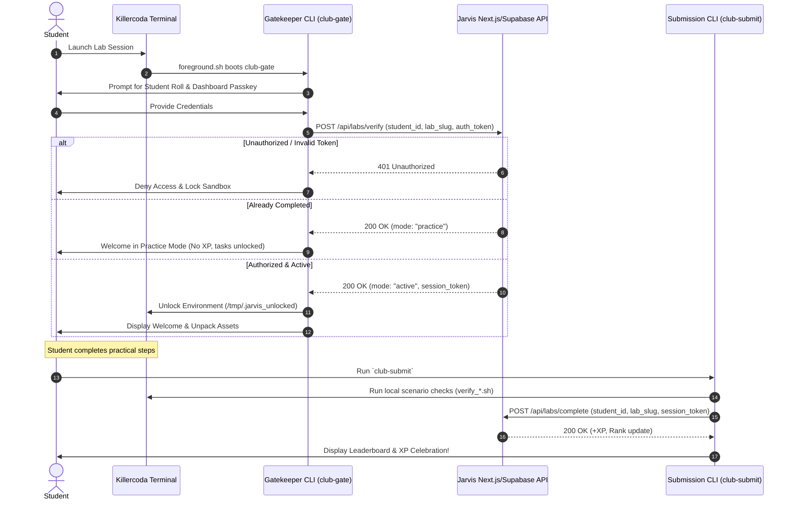

# IITM Jarvis Linux & Systems Club — Killercoda Interactive Lab Platform

Dedicated repository for hosting **Killercoda interactive scenarios**, automated environment setups, and student identity/XP verification tooling for the **IITM Jarvis Linux & Systems Club**.

The platform integrates directly with the Jarvis Club web portal ([jarvis-linux-club.vercel.app](https://jarvis-linux-club.vercel.app)) to authenticate students, prevent unauthorized execution, enable practice mode for completed labs, and award XP upon verified completion.

---

## 🏛️ System Architecture



---

## 📂 Active Scenarios

### `scenarios/intro-to-linux/` (Week 1 Session I: The Map, The Vehicle, and The Drive)
Comprehensive lab covering the curriculum in `W1S1.pptx`:
- **Step 1: Welcome & Club Authentication**: Verify terminal environment and establish kernel/shell communication (`echo "Hello Linux"`).
- **Step 2: Hands-On Practice 1 (Navigation & Visibility)**: Absolute vs. relative paths, `pwd`, `cd /var/log`, `cd ..`, `ls -la`, and `cd ~`.
- **Step 3: Hands-On Practice 2 (Create, Duplicate & Move)**: `mkdir sandbox`, `cd sandbox`, `touch data.csv`, `cp data.csv backup.csv`, `mkdir archive`, `mv backup.csv archive/`, and `tree`.
- **Step 4: Hands-On Practice 3 (Viewing Data & Safe Deletion)**: Inspecting with `cat /etc/hostname`, `head -n 3 /etc/passwd`, directory deletion constraints with `rm`, and recursive removal with `rm -r garbage`.
- **Step 5: Mini-Lab Synthesis Challenge**: Full end-to-end synthesis task from Slide 18 creating `/tmp/project/source/main.c`, moving, renaming to `script.sh`, executing, verifying, and recursive clean-up followed by `club-submit`.

---

## 🚀 Setting Up Killercoda Creator Dashboard

To host these scenarios on Killercoda:

1. **Sign in to Killercoda:** Navigate to [killercoda.com/creator](https://killercoda.com/creator).
2. **Link GitHub Repository:**
   - Connect your GitHub organization/account (`Jarvis-society-iitm` or your repository).
   - Point your Killercoda profile to this repository (`killercoda-setup`).
3. **Webhook & Sync:**
   - Configure automatic webhooks so every push to `main` updates your live scenarios.
4. **Directory Mapping:**
   - Killercoda reads scenarios defined in directories matching the structure in `scenarios/`.

---

## 🔒 API Endpoints & Contract

The verification scripts communicate with two core backend endpoints:

### 1. `POST /api/labs/verify`
Validates student identity and current completion state.

**Request:**
```json
{
  "student_id": "25f3002130",
  "lab_slug": "linux-basics-101",
  "auth_token": "user-passkey-from-dashboard"
}
```

**Responses:**
- **Success (Active - XP Eligible):**
  ```json
  {
    "success": true,
    "mode": "active",
    "message": "Student verified successfully.",
    "session_token": "signed-session-jwt"
  }
  ```
- **Success (Practice Mode - Already Completed):**
  ```json
  {
    "success": true,
    "mode": "practice",
    "message": "Lab previously completed. Entering Practice Mode.",
    "session_token": "signed-practice-token"
  }
  ```
- **Unauthorized / Error:**
  ```json
  {
    "success": false,
    "message": "Invalid credentials or unauthorized student."
  }
  ```

### 2. `POST /api/labs/complete`
Records completed tasks and credits student XP.

**Request:**
```json
{
  "student_id": "25f3002130",
  "lab_slug": "linux-basics-101",
  "session_token": "signed-session-jwt",
  "completed_at": "2026-11-01T16:00:00Z"
}
```

**Response:**
```json
{
  "success": true,
  "xp_awarded": 3,
  "total_xp": 685,
  "rank": 4,
  "message": "Awesome work! XP credited to your profile."
}
```
