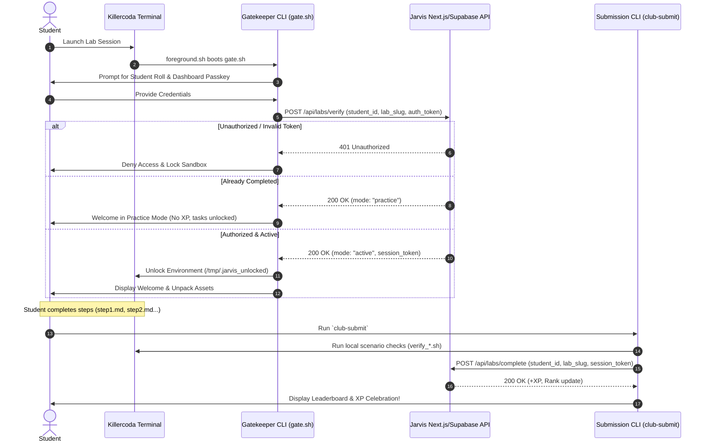

# IITM Jarvis Linux & Systems Club - Killercoda Interactive Lab Platform

Dedicated repository for hosting **Killercoda interactive scenarios**, automated environment setups, and student identity/XP verification tooling for the **IITM Jarvis Linux & Systems Club**.

The platform integrates directly with the Jarvis Club web portal ([jarvis-linux-club.vercel.app](https://jarvis-linux-club.vercel.app)) to authenticate students, prevent unauthorized execution, enable practice mode for completed labs, and award XP upon verified completion.

---

## 🏛️ System Architecture



---

## 📂 Repository Layout

```text
├── .gitignore
├── README.md
├── mock-server/
│   └── server.js               # Node.js mock API for offline/local testing
├── scenarios/
│   └── intro-to-linux/         # Sample scenario definition
│       ├── background.sh       # Silent VM prep (packages, tool setup)
│       ├── foreground.sh       # Launches gatekeeper CLI on student login
│       ├── index.json          # Killercoda manifest (steps, environment, metadata)
│       ├── intro.md            # Scenario introduction
│       ├── step1.md            # Step 1: Authentication guide
│       ├── step1-verify.sh     # Step 1 verification script
│       ├── step2.md            # Step 2: File operations & permissions
│       ├── step2-verify.sh     # Step 2 verification script
│       ├── step3.md            # Step 3: Environment variables & scripts
│       ├── step3-verify.sh     # Step 3 verification script
│       └── finish.md           # Scenario completion overview
├── scripts/
│   ├── club-submit.sh          # Task validation & XP completion submission tool
│   ├── gate.sh                 # Interactive ASCII terminal gatekeeper CLI
│   └── verify-gate.sh          # Helper to ensure unlock status in step scripts
└── tests/
    └── run-tests.sh            # Automated verification test suite
```

---

## 🚀 Setting Up Killercoda Creator Dashboard

To host these scenarios on Killercoda:

1. **Sign in to Killercoda:** Navigate to [killercoda.com/creator](https://killercoda.com/creator).
2. **Link GitHub Repository:**
   - Connect your GitHub organization/account.
   - Point your Killercoda profile to this repository (`killercoda-setup` or your club repo).
3. **Webhook & Sync:**
   - Configure automatic webhooks so every push to `main` updates your live scenarios.
4. **Directory Mapping:**
   - Killercoda reads scenarios defined in directories matching the structure in `scenarios/`.

---

## 🔒 API Endpoints & Contract

The verification scripts communicate with two core backend endpoints:

### 1. `POST /api/labs/verify`
Validates student identity and current completion state.

**Request:**
```json
{
  "student_id": "21f1001230",
  "lab_slug": "intro-to-linux",
  "auth_token": "user-passkey-from-dashboard"
}
```

**Responses:**
- **Success (Active - XP Eligible):**
  ```json
  {
    "success": true,
    "mode": "active",
    "message": "Student verified successfully.",
    "session_token": "signed-session-jwt"
  }
  ```
- **Success (Practice Mode - Already Completed):**
  ```json
  {
    "success": true,
    "mode": "practice",
    "message": "Lab previously completed. Entering Practice Mode.",
    "session_token": "signed-practice-token"
  }
  ```
- **Unauthorized / Error:**
  ```json
  {
    "success": false,
    "message": "Invalid credentials or unauthorized student."
  }
  ```

### 2. `POST /api/labs/complete`
Records completed tasks and credits student XP.

**Request:**
```json
{
  "student_id": "21f1001230",
  "lab_slug": "intro-to-linux",
  "session_token": "signed-session-jwt",
  "completed_at": "2026-10-19T15:00:00Z"
}
```

**Response:**
```json
{
  "success": true,
  "xp_awarded": 200,
  "total_xp": 650,
  "rank": 7,
  "message": "Awesome work! XP credited to your profile."
}
```

---

## 🧪 Local Testing & Mock Server

You can run full end-to-end tests without connecting to production:

### 1. Run Automated Test Suite
```bash
./tests/run-tests.sh
```

### 2. Run the Mock Server Manually
```bash
node mock-server/server.js
```
The mock server runs at `http://localhost:4000` with test accounts:
- `21f1001230` / `valid-token-123` (Active student)
- `22f2000456` / `valid-token-456` (Practice mode student)

### 3. Test Scripts in Mock Mode
```bash
# Test Gate with offline mock mode
MOCK_API=true ./scripts/gate.sh intro-to-linux

# Test Gate targeting local mock server
API_URL=http://localhost:4000 ./scripts/gate.sh intro-to-linux

# Test Submission
MOCK_API=true ./scripts/club-submit.sh
```

---

## 🛠️ Adding a New Lab Scenario

1. Copy the template:
   ```bash
   cp -r scenarios/intro-to-linux scenarios/advanced-kernel-modules
   ```
2. Update `index.json`:
   - Change `title`, `description`, `time`, and `difficulty`.
   - Update step references and verification scripts.
3. Update `foreground.sh`:
   - Set `LAB_SLUG="advanced-kernel-modules"`.
4. Define your challenge in `step1.md`, `step2.md`, etc., and implement checks in `step*-verify.sh`.
5. Push to GitHub and test in the Killercoda Creator interface.

